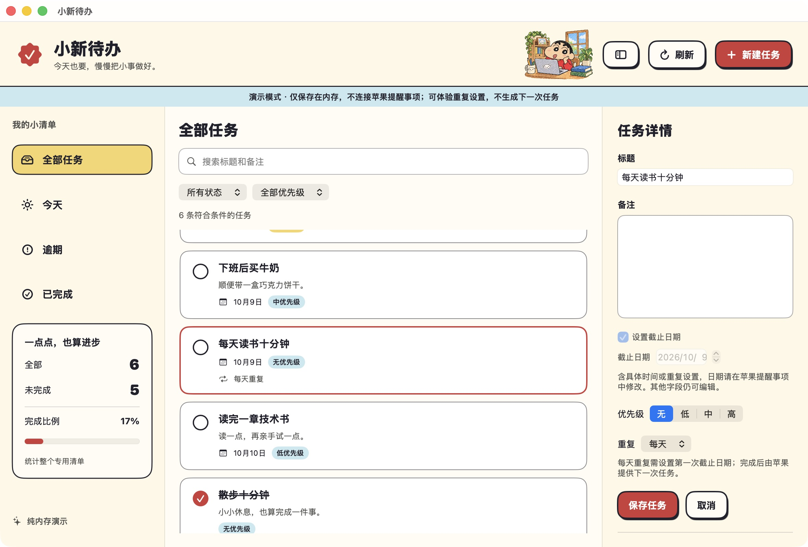

## 工程维护入口（2026-10-29）

本次按已提交 `main`（`ec5812c40b73b6befeaa7391e5894a37f1e16431`）补录工程与 OpenSpec 基线；下方原有产品介绍、署名和许可保留。历史验证记录不代表本次重新完成真机、云端或发布验收。

SwiftUI 原生 Mac 个人待办；源码为 0.4.0/build 8，EventKit 限定专用清单，专注记录为本地 JSON；不把本机写入等同 iCloud 同步完成。

- [工程基线与验收边界](docs/engineering-baseline.md)
- [项目开发约定](AGENTS.md)
- [OpenSpec 维护流程](openspec/README.md)

# 小新待办 · Mac 个人待办应用

当前本地版本：0.4.0（build 8），升级重复规则显示与编辑，支持常用预设、自定义间隔、星期/月内日期和结束条件；保留任务番茄钟、专注统计、手机摘要及卡片点击/手动时长输入。公开下载目前仍为 0.3.1，0.4.0 尚未发布。

个人使用的原生 Mac 待办应用。Mac 用这个界面，iPhone 用苹果提醒事项，数据来自你新建并绑定的一个专用 iCloud 清单。没有独立服务器、账号系统、第三方依赖或任务数据库。

## 能帮你做什么

适合想在 Mac 上使用简洁、轻松的待办界面，同时继续在手机上使用苹果提醒事项的人。

| 你的需求 | 应用提供的帮助 |
| --- | --- |
| 把零散的小事记下来 | 新增、编辑、完成、恢复任务；记录标题、备注、截止日期与优先级 |
| 快速找到当前要做的事 | 全部、今天、逾期、已完成视图；组合状态和优先级筛选；搜索标题及备注 |
| 安排重复学习任务 | 每天、工作日、周末、每周、每两周、每月、每年；自定义间隔、星期、月内日期/次序和结束条件；苹果生成下一次任务 |
| 给学习任务安排专注时间 | 每条任务设置专注时长；开始、暂停、继续和重置；专注结束后自行选择下一步 |
| 了解学习投入 | 今日、本周完整专注轮数与分钟数；手机提醒事项查看任务专注摘要 |
| 看清整体进度 | 专用清单总量、未完成数、完成比例；搜索和筛选不会改变统计口径 |
| 沿用苹果生态 | 接入明确新建的专用提醒事项清单，跨设备数据同步交给 iCloud，不另建账号 |
| 减少误操作与丢失编辑内容 | 删除二次确认；保存前核对外部变化；失败或冲突保留草稿；权限或清单失效时停止写入 |
| 在正式连接前体验 | 独立纯内存演示，无需提醒事项授权，不访问真实任务 |

它也可以作为原生个人工具的学习与作品集项目：包含需求、技术设计、开发约定、模块化源码、可复现测试和验收记录，展示完整用户流程及系统权限、数据边界与错误处理。已实现能力和实机验收结果分别记录，不能用演示或测试通过代替同步验证。

## 技术栈与技术选型

本项目面向个人 Mac 日常使用，手机端继续使用苹果提醒事项，因此采用 **Swift + SwiftUI 原生应用**。界面由 SwiftUI 构建，状态管理使用 Combine 的 ObservableObject 和 @Published，样式使用 SwiftUI 的布局、颜色、形状与 ButtonStyle，日期处理使用 Foundation 的 Calendar 与 DateComponents，任务读写通过 EventKit 接入苹果提醒事项，本地绑定信息使用 UserDefaults 保存，专注记录使用原子 JSON 文件保存，专注提醒使用 UserNotifications。构建采用 Swift Package Manager 和 Bash 脚本，首版不引入第三方依赖。

### 界面与开发语言：Swift + SwiftUI

Swift 用于定义任务模型、查询规则、状态控制器和系统数据访问。SwiftUI 是苹果提供的声明式界面框架，用于构建侧栏、任务列表和编辑面板，并使用原生输入框、日期选择器、窗口及快捷键完成交互。选择这套方案，是因为当前要交付的是能接入提醒事项的 Mac 应用，原生界面可以直接配合系统权限和 EventKit 工作，也方便保持 macOS 的键盘操作与可访问性习惯。最低系统版本为 macOS 14；当前使用 Swift 6.3.1 编译器，Package 使用 Swift 5 语言模式。

### 状态管理：Combine + TodoController / FocusController

任务列表、当前视图、搜索词、优先级筛选、编辑草稿、连接阶段以及加载和错误状态，由 TodoController 集中管理。Combine 是苹果提供的事件发布与订阅框架。控制器实现 ObservableObject，通过 @Published 发布变化；应用使用 @StateObject 持有控制器，子视图使用 @ObservedObject 观察同一个实例。这样，完成任务后列表和统计能够一起更新，编辑失败时草稿也能继续保留。

FocusController 单独管理专注会话、时长偏好、完成记录、通知和本地保存错误；TodoController 继续负责任务与编辑草稿。两个控制器由应用持有，多个窗口共享同一个专注会话，查看其他任务不会切换正在计时的任务。

选择系统自带的状态管理机制，是因为当前原生 Mac 的单清单与单计时器范围已能通过它覆盖共享状态和界面更新。Zustand 服务于 JavaScript / React 的状态订阅，当前 SwiftUI 界面采用苹果框架即可完成对应职责，无需引入网页运行环境。控制器负责新增、保存、完成、删除、刷新等操作的组织，筛选规则放在 TaskQuery 中，EventKit 调用放在适配层，避免把系统读写和业务规则堆进视图。[SwiftUI 状态对象文档](https://developer.apple.com/documentation/swiftui/stateobject)

### 样式与布局：SwiftUI 原生样式

样式由 Theme.swift 统一定义奶油色背景、红黄强调色、圆角描边和按钮外观，通过自定义 ButtonStyle 与 ViewModifier 复用。三栏采用 HSplitView，列表和编辑表单分别滚动，侧栏支持折叠；任务详情放专注卡片，窗口底部放全局计时栏，使用 ViewThatFits 根据可用宽度选择横排或分行，避免继续挤压顶部按钮；装饰插画作为本地资源打包，不参与任务交互。

这套实现可以在保持原生控件行为的同时表达蜡笔小新的卡通风，并让字体、边距、按钮状态和减少动态效果集中维护。命中区域也是界面实现的一部分：侧栏菜单明确设置整行点击形状，任务卡片的编辑按钮覆盖完整卡片，包括边缘留白；左侧完成圆圈是独立兄弟按钮，描边不参与命中。按钮阴影只绘制在背景上，避免文字和图标重影。

### 日期处理：Foundation Calendar + DateComponents

任务截止日期精确到日，使用 Gregorian 的年、月、日组件写入提醒事项，不加入时分秒。读取后按用户当前时区的本地日历判断「今天」和「逾期」；没有日期的任务不会被算作逾期，排序时放在有日期的任务后面。

Foundation 是系统基础库，提供 Calendar 等日期工具。选择它，是因为这些日历组件能够同时服务于日期筛选和 EventKit 日期读写，满足当前按日管理的需求。应用重新激活、本地日期变化或时钟更新时重新计算视图，避免跨午夜后仍使用昨天的日期边界。

### 数据存储与同步：EventKit + 苹果提醒事项 + UserDefaults + JSON

任务的真实数据存放在苹果提醒事项中，EventKit 是苹果提供的日历与提醒事项访问框架，EventKitBackend 通过它创建清单、读取记录和提交修改。用户明确选择 iCloud 账户并创建专用清单后，应用只操作绑定清单；Mac 与 iPhone 的跨设备同步由苹果的 iCloud 提醒事项机制承担。本地 UserDefaults 仅保存清单标识，任务快照、筛选状态和未保存草稿保留在内存中。

专注记录使用 Foundation 的 Codable 编解码，FileFocusStore 将带版本的 JSON 原子写入应用专用 Application Support 目录。文件包含每轮 UUID、归属标识、时长、完成日期、偏好与恢复检查点，不保存任务标题或正文；损坏时保留文件并停止覆盖，写入失败暂停并保留内存内容。完整专注历史留在这台 Mac，手机只通过 EventKit 写入的独立备注信息段查看摘要。选择 JSON，是因为当前只需单机保存与恢复，增加数据库或 Firebase 会带来新的同步、权限和维护边界。

这项选择服务于「Mac 用自制界面、手机继续用苹果提醒事项」的目标，也减少了独立任务数据库、账号和同步服务的维护工作。它仍依赖用户的账户设置、系统权限和苹果同步条件；本机保存成功只表示本机接收写入，真实重复生成、重启保留和两端同步需要单独验收。

### 专注计时：Foundation 单调时钟 + FocusEngine

FocusEngine 是可注入时钟的独立状态机，使用 ProcessInfo.systemUptime 的时间差计算剩余时长。Timer 每秒驱动界面更新，约每 5 秒保存检查点；即使回调迟到，也按真实经过的运行时间计算，不通过回调次数每次减一。每轮 UUID 防止重复完成事件或重启造成重复计数，Calendar 按完成日期计算今日和周一开始的本周统计。

AppKit 生命周期事件用于休眠和正常退出前暂停，恢复后需要手动继续；正常退出等待在途通知安排结束再取消。异常退出从最近检查点恢复为暂停并说明时间可能存在偏差。这套实现不用常驻后台服务，测试能直接推进时钟验证边界，无需等待真实的 25 分钟。

### 到时提醒：UserNotifications + AppKit NSSound

UserNotifications 安排一次性本地系统通知，由用户点击「启用通知」才请求权限。暂停、重置或放弃时取消对应请求；异步安排带代次检查，避免已经取消的旧请求随后重新生效。通知使用通用的专注或休息结束文案，不包含任务正文。

AppKit 的 NSSound 提供本机提示音；已有系统通知声音请求时不额外播放，避免重复发声。拒绝通知权限仍能计时并看到界面提示。选择系统通知和声音接口，是为了配合原生应用且无需浏览器 Notification API 或音频依赖；通知实际呈现仍受系统设置、专注模式和授权状态影响。

### 构建与测试：Swift Package Manager + Bash + CoreChecks

Swift Package Manager 将项目组织为 TodoCore（模型和业务规则）、TodoSystem（系统与演示适配器）、ShinchanTodo（界面程序）和 CoreChecks（可执行检查）。Bash 脚本负责 release 编译、组装资源与 Info.plist、生成 `.app` 并执行本地 ad-hoc 签名检查。这让源码克隆后有明确、可重复的构建入口，当前使用已安装的 Swift 命令行工具。

自动检查运行真实查询、服务和控制器逻辑，系统数据库边界使用内存适配器，重复规则映射使用真实 EKRecurrenceRule 对象。当前自动检查结果见 ACCEPTANCE.md 的 0.4.0 记录，包含原有任务/专注检查及新增重复规则边界。由于本机构建环境缺少 Swift Testing 运行库，采用失败时返回非零退出码的 CoreChecks；这些检查不请求提醒事项授权，也不能代替真实 EventKit 和 iPhone 验收。

## 关键技术点

### 1. 共享状态与编辑草稿分开管理

TodoController 中的 tasks 是读取到的任务快照，draft 是尚未提交的编辑内容。新增、编辑、切换任务和刷新通过控制器统一组织；界面根据发布的状态更新。有未保存修改时，切换任务或新建需要确认放弃，刷新也不会覆盖草稿。这样可以让列表保持最新，同时保护用户正在输入的内容；草稿没有持久化，退出应用前仍需保存。

### 2. 多条件筛选与关键词搜索

TaskQuery 将当前视图、完成状态、优先级和搜索词组合判断，条件之间采用「同时满足」的规则。例如，选择「今天 + 未完成 + 高优先级」，再搜索「读书」，只显示截止日期为今天、尚未完成、优先级为高，并且标题或备注包含该关键词的任务。

搜索先去掉关键词首尾空白，再在标题和备注中进行不区分大小写的包含匹配；空搜索不限制结果。这里的模糊搜索指关键词包含匹配，例如「读书」能找到「每天读书十分钟」，暂不包含拼写纠错或语义搜索。当前没有任务分类字段，组合筛选以已实现的视图、状态和优先级为准。

### 3. 日期、排序与统计保持统一口径

「今天」和「逾期」只包含未完成任务，以本地日历日为判断边界。任务默认按截止日期升序排列，无日期置后；同日按优先级降序，再按创建时间和标识稳定排序。统计直接使用整个绑定清单的任务快照，总量、未完成数和完成比例不会随搜索筛选变化；空清单的完成比例为 0%。因此「找到几条任务」与「整个清单完成了多少」有各自明确的含义。

### 4. 完整系统权限下限制单清单操作

苹果系统要求完整提醒事项读写权限，应用在首次连接时说明原因，由用户授权。设置阶段只枚举账户和清单元数据，用户确认 iCloud 账户后明确创建新清单，不凭名称接管已有清单。

每次读取和写入都检查授权、绑定清单存在及可写；列表查询明确传入该清单，单条操作也核对任务归属。权限撤销、清单删除或任务移到其他清单时停止操作。权限范围和应用自身的操作范围分别明确，减少误碰其他清单的风险。

### 5. 保存前检查冲突，区分写入和刷新失败

打开任务时保留其版本签名，编辑、完成或删除前重新读取并刷新原生记录，核对清单和版本。若发现其他地方已修改，则停止覆盖、提示核对并保留草稿；用户选择「载入最新」后才重新读取内容。

写入失败时保留编辑内容；写入成功但后续读取失败时，明确提示「已保存，但重新加载失败」，避免用户把已经完成的写入再提交一次。EventKit 没有提供这里所需的原子版本比较写入，仍不能保证检查与保存之间的跨设备并发被完全阻止，这个限制保留在真实验收记录中。

### 6. 重复规则使用苹果原生数据

RepeatSchedule 管理天/周/月/年频率、间隔、星期、月内日期/次序和结束条件，ReminderRecurrence 负责与 EKRecurrenceRule 双向映射。常用预设包含每天、工作日、周末、每周、每两周、每月、每年，自定义间隔为 1～999；每周可多选星期，每月可多选日期/月末或第几个星期几，结束可为永不、指定日期或总次数（含首次）。指定最后日期按本地日历日末计算，覆盖夏令时变化。

手机已有带时间的常见规则也能识别和修改重复；日期、时间和原有提醒继续保持，日期控件仍只读。只有明确保存重复变化才替换原生规则，普通备注编辑不重建；取消支持的规则保留原日期。无法安全重建的组合详细显示并只读，避免把手机规则降级覆盖。原生接口没有每小时频率，不承诺完全复制苹果界面的所有选项。

完成当前一次后由苹果提供下一次任务，应用刷新绑定清单；不自行复制任务或安排后台定时器。月末、闰日和不存在的月内日期也由苹果处理。真实写入、下一次生成、重启及手机反向同步须单独实测，演示只保存设置。

### 7. 异步刷新避免旧结果覆盖新状态

系统提醒事项变化和应用重新激活会触发读取。每次刷新带有递增的请求代次，并记录当时的清单标识；返回时只有仍属于当前请求和当前绑定的结果才能更新界面。这样，即使较早的请求更晚返回，或用户已解除绑定，旧结果也不会覆盖较新的状态或重新带回旧清单数据。

### 8. 演示与真实系统数据隔离

DemoBackend 和 EventKitBackend 实现同一个数据边界，演示复用真实的界面、控制器和业务逻辑，但任务只保存在独立内存中。演示适配器不初始化 EKEventStore、不读取真实绑定和任务，方便在授权前检查操作，也便于对写入失败、冲突和权限变化进行可控测试。演示可以体验支持的重复设置，不模拟苹果生成下一次任务；演示结果和真实同步验收分别记录。

实现数据流：**SwiftUI 界面 → TodoController 状态与草稿 → ReminderService 单清单守卫 → EventKitBackend → 苹果提醒事项**。详细边界和验收见 [TECH_DESIGN.md](TECH_DESIGN.md) 与 [ACCEPTANCE.md](ACCEPTANCE.md)。

## 界面预览

以下均为自造演示数据。



## 获取并运行

当前已公开的旧版可在 [0.3.1 Release](https://github.com/zhazhahuiyuxiaoxiao/shinchan-todo/releases/tag/v0.3.1) 下载 [Apple Silicon 应用包](https://github.com/zhazhahuiyuxiaoxiao/shinchan-todo/releases/download/v0.3.1/shinchan-todo-mac-arm64-0.3.1.zip)，解压得到「小新待办.app」。版本为 0.3.1（build 7），最低要求 macOS 14；只在当前 Apple Silicon Mac 验证过，Intel 不适用。包使用本地 ad-hoc 签名，尚未进行正式开发者签名和 Apple 公证，其他 Mac 是否接受由系统安全策略决定。首次可选择纯内存演示。Release 同时提供 SHA256SUMS.txt 校验文件。

源码、测试和文档保存在仓库；应用包作为 Release 附件提供，缓存、偏好和个人数据不加入 Git。也可以在 Mac 上从源码构建：

```bash
git clone https://github.com/zhazhahuiyuxiaoxiao/shinchan-todo.git
cd shinchan-todo
bash scripts/test.sh
bash scripts/build-app.sh
open "dist/小新待办.app"
```

需要 macOS 14 以上和支持 Package 6.0 的 Swift 命令行工具。构建脚本使用已有工具，不自动安装 Xcode 或第三方依赖。

## 打开应用

构建生成 `dist/小新待办.app`。双击打开即可；首次可先点「先体验演示」，检查界面和操作，演示数据只在内存中，结束演示后丢弃，不会访问真实提醒事项。

实际使用时：

1. 退出演示，点击「连接苹果提醒事项」。苹果要求完整提醒事项读写权限，由你完成系统授权；本应用的查询和修改限制到绑定清单。
2. 选择你自己的 iCloud 提醒事项账户，核对后勾选确认，再点击「创建全新的专用清单」。CalDAV 类型本身不能证明账户是 iCloud；切换账户会清除确认。已有同名清单不会被接管，新清单使用可区分的名字。
3. 新建任务并保存，在苹果提醒事项中核对。本机写入成功不表示手机已经同步，手机同步由苹果负责。

没有候选账户时，先在系统设置中启用 iCloud 提醒事项，并确认苹果提醒事项有一个可写的普通清单，再回到应用检查。权限拒绝或撤销后，由你在「系统设置 → 隐私与安全性 → 提醒事项」允许，再检查连接。应用不会修改系统账号或权限设置。

清单标识失效后停止操作；「重新设置新清单」只解除绑定，不删除旧清单或任务，不自动寻找同名清单。

## 日常操作

- Command N 新建、Command S 保存、Command R 刷新、Command Option B 折叠侧栏。原生文本输入支持选择、复制、粘贴和 Tab 焦点切换；按钮完整键盘导航取决于 macOS 的键盘导航设置。
- 编辑有明确保存与取消；有草稿时切换任务、新建或载入最新需确认放弃。保存或重新读取失败时草稿保留。退出应用前请先保存，草稿没有持久化。
- 搜索标题和备注，组合状态与优先级筛选；侧栏统计始终计算整个专用清单。
- 今天、逾期仅包含未完成任务；无日期不算逾期。截止日期只到日，不配置任务到期通知；专注结束提醒独立配置。
- 每天要做的事：新建或编辑未完成任务 → 设置截止日期（第一次任务日期）→「重复」选「每天」→ 保存。完成当前一次后由苹果提供下一次未完成任务，刷新查看；真实 EventKit 及手机同步仍待验收。
- 编辑重复：在任务详情选择常用预设，或选「自定义」填写条件，再保存任务。间隔和次数可手动输入；错误输入阻止保存并保留草稿。工作日指周一至周五，不判断节假日。
- 停止可编辑的重复：选择「无」并保存，原日期保留。已完成任务须先恢复；不支持的规则在苹果提醒事项管理。
- 演示可以体验重复选择及保存，但不生成下一次任务，结束后丢弃。
- 删除须确认，会影响苹果提醒事项及同步设备。
- 外部任务带时间或重复规则时，日期在本应用只读；其他支持字段仍可编辑，并保留原有高级属性。

## 构建与测试

应用图标源图为 `Packaging/AppIcon.png`。打包时 `scripts/build-icon.sh` 使用 macOS 自带的 sips 和 iconutil 生成 16–1024 像素的多尺寸 `.icns`，复制到应用 Resources，并通过 Info.plist 的 CFBundleIconFile 指定。图标来源和生成提示词见 [Packaging/AssetSources.md](Packaging/AssetSources.md)。

要求 macOS 14 以上，以及支持 Swift Package 6.0 的 Swift 命令行工具。本次使用已有 Swift 6.3.1，不安装 Xcode。

在项目目录运行：

```bash
bash scripts/test.sh
bash scripts/build-app.sh
```

测试用可执行的 `CoreChecks`：失败会打印断言并以非零状态退出。当前 CLT 的 Swift Testing 缺少 `lib_TestingInterop.dylib`，所以没有使用 `swift test`，也没有伪称其通过。测试使用真实 EKRecurrenceRule 对象和内存数据边界，不请求系统权限、读取私人任务或改动 iCloud。

构建生成 `dist/小新待办.app`，包含权限说明、插画、系统框架链接和本地 ad-hoc 签名。仅本机 Apple Silicon 构建已运行；没有正式开发者账号签名或公证，不能保证其他 Mac 直接接受；用户已批准将 0.3.1 体验包提供为 Release 附件。最低版本声明与二进制为 macOS 14，但尚未在 macOS 14 真机运行。更新自用构建后，系统可能要求再次授权。

## 项目文件

- `PRD.md`：范围、用户行为、数据边界与验收标准。
- `TECH_DESIGN.md`：模块、EventKit 接入、冲突及刷新处理。
- `AGENTS.md`：后续开发约定。
- `Sources/TodoCore/`：任务、查询统计、单清单服务、草稿、专注状态机与备注摘要。
- `Sources/TodoSystem/`：EventKit、JSON 专注存储、系统通知、应用生命周期及纯内存演示适配器。
- `Sources/ShinchanTodo/`：原生界面与资源。
- `Tests/TodoCoreTests/`：自动检查。
- `Packaging/Info.plist`、`scripts/`：原生应用打包与验证。
- `ACCEPTANCE.md`：当前证据和需要你参与的真实验收。

## 当前验证与限制

- 自动业务检查：结果见 ACCEPTANCE.md 最新记录，覆盖原有任务与专注及新增重复规则；release 构建、Info.plist 与本地签名校验通过。演示中已检查开始、暂停、换任务确认、1 分钟到零及统计、中文草稿保留和正常退出。
- 常见重复规则已接入原生映射；真实 EventKit 写入、完成后下一次生成、重启保留及 iPhone 同步仍需在专用测试清单验收。
- 任务卡片边缘与留白点击已由用户在本机手动验收通过（2026-10-10）。真实通知、Mac 休眠恢复、手机专注摘要同步、最小窗口、跨窗口失焦及完整键盘导航仍待实测；侧栏空白处点击的旧验收缺口保留。
- 不提供任务分类、子任务、每小时重复编辑、任务到期通知设置或习惯打卡分析。多条原生规则、非公历、不同周起点和未覆盖的 BY 组合详细显示并只读。
- 仓库提供个人工具源码展示及 0.3.1 Release 体验包；应用为 Apple Silicon 构建，没有正式开发者签名或公证。macOS 14 真机尚未实测，当前下载包不支持 Intel。

完整证据、操作步骤和待验收项见 [ACCEPTANCE.md](ACCEPTANCE.md)。

## 素材与许可证

小新插画复用生成的作品集装饰素材，来源和使用边界见 [AssetSources.md](Sources/ShinchanTodo/Resources/AssetSources.md)。原角色知识产权归权利人，素材来源记录不代表商业授权。

本仓库用于个人项目展示与学习参考，尚未选定开源许可证；不将角色插画作为可自由商用素材承诺。


## 0.3.0：任务专注番茄钟

选中已保存、未完成的任务，在详情下方设置本次专注分钟数，点击「开始专注」。默认 25 分钟，可选 1～180 分钟；短休息默认 5 分钟，可选 1～60 分钟。两项都可直接输入数字，按回车或离开输入框保存，也可用加减按钮调整。空值、文字、小数或越界值会在对应输入框下提示，保留原设置并阻止启动；启动前再次校验当前输入，正在进行的一轮时长保持不变。底部始终显示当前任务和 MM:SS，可暂停、继续、重置或确认放弃；切换其他任务、搜索和最小化不改变正在计时的任务。未保存的新任务需要先保存。

专注到零记录一轮，由你选择短休息、再来一轮或手动完成任务。休息结束不会自动开始工作。只有完整结束的专注计入轮数和分钟数，重置、放弃、暂停和休息不计数。今日按完成日期统计，本周从周一开始；统计来自本机全部专注记录，不随任务筛选变化。

Mac 合盖休眠、正常退出时暂停，重新打开后手动继续；异常终止后从最多约 5 秒前的检查点暂停恢复。应用使用单调时间计算已过去的时间，界面每秒刷新展示，不靠回调次数减秒，减少后台延迟造成的误差。系统调度和通知设置仍影响提醒实际呈现时间。

### 新增技术选型及原因

- **状态管理：Combine / ObservableObject。** FocusController 发布独立的计时、记录、保存错误和提醒状态；TodoController 继续管理提醒事项和编辑草稿。一个应用实例中的多个窗口共用计时控制器，避免各自开始不同计时。
- **计时：Foundation 单调时间与纯状态机。** ProcessInfo.systemUptime 提供运行时间来源，FocusEngine 根据时间差重新计算剩余秒数。Timer 仅驱动展示和检查点，测试注入时钟，无需等待真实分钟。
- **本地保存：Foundation Codable + 原子 JSON 文件。** 保存在用户 Application Support/local.zhazhahui.shinchan-todo/Focus.json，包含版本、时长偏好、已完成记录、待写摘要和恢复检查点。无需数据库或云账号；损坏文件保留并停止覆盖，保存失败保留内存内容且暂停。
- **提醒：UserNotifications + AppKit 本机提示音。** 点击「启用通知」才请求系统权限；安排一次性本地通知，暂停、重置和放弃时取消。系统通知带声音时应用不重复播放；未授权时仍显示应用内提醒，并可使用本机提示音。通知只描述专注/休息结束，不含任务正文。[苹果本地通知文档](https://developer.apple.com/documentation/usernotifications/scheduling-a-notification-locally-from-your-app)
- **手机查看：EventKit 备注摘要 + 苹果 iCloud。** 摘要使用有版本的可读信息段，显示每轮分钟数、当前一次任务的本机累计轮数/分钟数及最近完成时间。原备注与摘要分别编辑、合并保存，沿用清单范围和版本检查。手机使用苹果提醒事项查看，不能控制 Mac 计时；完整历史不会自动迁移到另一台 Mac。

每天重复的下一次任务沿用备注中的专注时长，但按提醒事项标识和当次截止日期分别累计。历史记录仍计入 Mac 的日期统计。标识在苹果完整同步后可能变化，应用不会凭同名接管或把记录误并入其他任务。

备注摘要写入失败时显示「摘要未写入」，本地专注记录保留；先「载入最新任务」核对，随后重试写摘要。文件保存失败则使用底部「重试本地保存」；文件损坏时「重试读取」，不会以空记录覆盖原文件。专注记录未保存成功时，退出前会再次确认是否丢弃未保存内容。本机摘要已写入仅说明 EventKit 保存成功，手机同步需两端实测。

本功能能帮助学习时给具体任务安排一段专注时间、看到已完成轮数与投入分钟数；统计不等于学习质量或真实效率。首版不含手机计时、自动长休息、背景音乐、图表或独立云同步。
